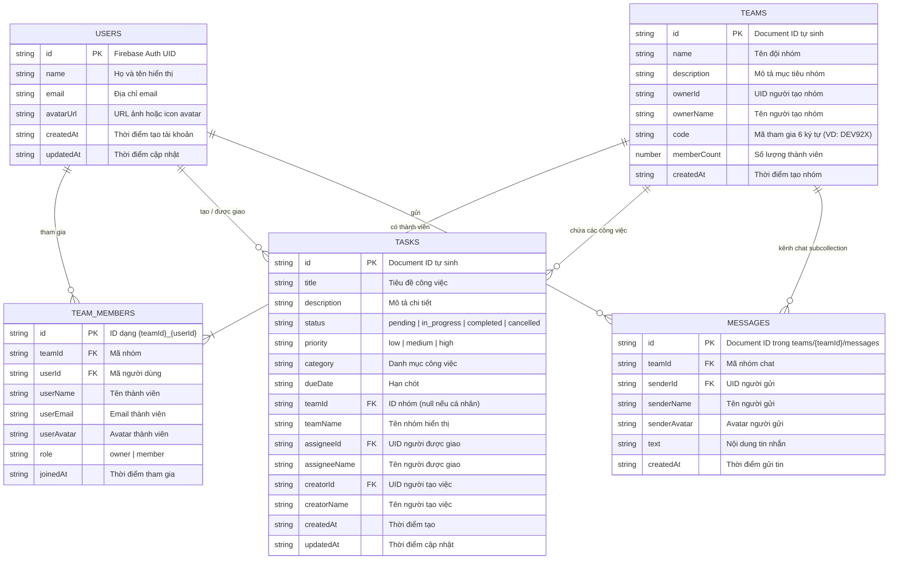

# TaskMaster Pro - Ứng dụng Quản lý Công việc: Xác thực, Đội nhóm & Chat Thời gian thực
> **Bài thi thực hành 2 – Môn: Phát triển Ứng dụng Di động (MMA)**  
> Phát triển tiếp nối từ Bài thi thực hành 1 trên nền tảng **React Native (Expo)** và **Firebase (Authentication, Cloud Firestore, Storage/ImagePicker)**.

---

## 🚀 Tính năng nổi bật trong Bài thi 2

### 1. Firebase Authentication (Xác thực người dùng)
- **Đăng ký tài khoản (Sign Up):** Nhập Tên, Email, Mật khẩu & Xác nhận mật khẩu. Tự động khởi tạo tài khoản Firebase Auth và tạo document tương ứng trong collection `users` trên Firestore.
- **Đăng nhập (Login):** Xác thực an toàn qua Firebase Auth với kiểm tra lỗi (sai mật khẩu, email không tồn tại, v.v.). Hỗ trợ nút điền nhanh tài khoản mẫu (Demo accounts) để giảng viên test nhanh.
- **Duy trì đăng nhập (Auth Persistence):** Tích hợp listener `onAuthStateChanged` cùng `@react-native-async-storage/async-storage` giúp duy trì trạng thái đăng nhập khi khởi động lại app.
- **Bảo vệ màn hình (Protected Navigation):** Điều hướng tự động nhận biết trạng thái đăng nhập. Người dùng chưa xác thực chỉ xem được màn hình Login/Sign Up; khi đăng nhập thành công sẽ vào toàn bộ tính năng chính.
- **Đăng xuất (Logout):** Đăng xuất an toàn từ màn hình Profile kèm hộp thoại xác nhận.

### 2. Quản lý Đội nhóm (Teams Management)
- **Tạo nhóm mới (Create Team):** Người dùng nhập Tên nhóm và Mô tả. Hệ thống tự động sinh Mã nhóm (Team Code) 6 ký tự viết hoa (VD: `DEV92X`) và gán người tạo làm **Trưởng nhóm (Owner)** trong collection `teamMembers`.
- **Tham gia nhóm (Join Team):** Tham gia nhanh chóng vào bất kỳ nhóm nào bằng cách nhập Mã nhóm (Team Code).
- **Chia sẻ mã nhóm (Share Code):** Nút sao chép và chia sẻ mã mời trực tiếp qua hệ thống.
- **Màn hình Chi tiết nhóm (Team Detail):** 
  - Xem thông tin nhóm, mã mời, nút mở kênh chat nhóm.
  - Danh sách thành viên trong nhóm kèm avatar, tên, email và phân quyền (Trưởng nhóm / Thành viên).
  - Danh sách các công việc thuộc về nhóm đó.
  - Phân quyền: Trưởng nhóm có quyền giải tán nhóm, thành viên có quyền rời nhóm.

### 3. Liên kết Công việc với Đội nhóm & Người thực hiện (Assignee)
- **Phân công công việc:** Form Tạo / Sửa công việc cho phép chọn Đội nhóm và chọn Thành viên cụ thể trong nhóm đó để gán việc (`assigneeId`, `assigneeName`).
- **Hiển thị trực quan:** Card công việc trên màn hình Home và Team Detail hiển thị rõ badge tên đội nhóm và tên/avatar của người được giao việc.
- **Bộ lọc thông minh (Scope Filter):** Màn hình Home hỗ trợ lọc theo:
  - *Tất cả*
  - *👤 Của tôi* (các việc do mình tạo hoặc được giao)
  - *👥 Nhóm* (các việc thuộc các đội nhóm tham gia)

### 4. Chat Thời gian thực cho từng Đội nhóm (Real-Time Team Chat)
- **Kênh chat riêng biệt:** Mỗi đội nhóm sở hữu một subcollection tin nhắn riêng tại `teams/{teamId}/messages`.
- **Lắng nghe thời gian thực (Real-time `onSnapshot`):** Tin nhắn gửi từ bất kỳ thành viên nào đều xuất hiện ngay lập tức trên màn hình của các thành viên khác mà không cần tải lại trang.
- **Giao diện bong bóng chat hiện đại (Modern Chat Bubbles):**
  - Tin nhắn của bản thân: Căn phải, nền màu chủ đạo tím/indigo (`#6366F1`), chữ trắng, hiển thị thời gian.
  - Tin nhắn của thành viên khác: Căn trái, nền thẻ trắng thanh lịch, hiển thị avatar và tên người gửi nổi bật.
- **Hiệu ứng đang gõ (Typing Indicator - Điểm cộng):** Hiển thị trạng thái "✏️ [Tên] đang nhập tin nhắn..." theo thời gian thực khi có người đang soạn tin.

### 5. Hồ sơ người dùng & Tùy biến Avatar (Profile & Custom Avatar)
- Hiển thị tên hiển thị, email, số lượng nhóm tham gia, số lượng công việc và trạng thái trực tuyến.
- **Đổi ảnh đại diện:** Hỗ trợ chọn ảnh từ thư viện thiết bị (`expo-image-picker`) hoặc chọn nhanh avatar từ bộ emoji phong phú.

---

## 🗄️ Sơ đồ Quan hệ Thực thể (ERD / Firestore Schema)



---

## 🔒 Quy tắc Bảo mật Firestore (Security Rules)

Nội dung file `firestore.rules` tại thư mục gốc dự án:

```javascript
rules_version = '2';

service cloud.firestore {
  match /databases/{database}/documents {

    function isAuthenticated() {
      return request.auth != null;
    }

    function isOwner(userId) {
      return isAuthenticated() && request.auth.uid == userId;
    }

    // 1. Users collection
    match /users/{userId} {
      allow read: if isAuthenticated();
      allow create, update: if isAuthenticated() && (request.auth.uid == userId || request.resource.data.id == request.auth.uid);
      allow delete: if isOwner(userId);
    }

    // 2. Teams collection & Subcollections
    match /teams/{teamId} {
      allow read, create: if isAuthenticated();
      allow update: if isAuthenticated();
      allow delete: if isAuthenticated() && resource.data.ownerId == request.auth.uid;

      match /messages/{messageId} {
        allow read, create: if isAuthenticated();
        allow update, delete: if isAuthenticated() && resource.data.senderId == request.auth.uid;
      }

      match /typing/{userId} {
        allow read, write: if isAuthenticated();
      }
    }

    // 3. TeamMembers collection
    match /teamMembers/{memberId} {
      allow read, create: if isAuthenticated();
      allow update, delete: if isAuthenticated();
    }

    // 4. Tasks collection
    match /tasks/{taskId} {
      allow read, create, update, delete: if isAuthenticated();
    }
  }
}
```

---

## 📁 Cấu trúc Thư mục Nguồn (Source Tree)

```text
Ass1_MMA/
├── src/
│   ├── components/
│   │   ├── BottomTabBar.tsx       # Thanh điều hướng Tab Bar
│   │   ├── EmptyState.tsx         # Component trạng thái rỗng
│   │   └── TaskCard.tsx           # Card hiển thị task kèm badge Team & Assignee
│   ├── context/
│   │   └── AuthContext.tsx        # React Context quản lý User & Auth State
│   ├── models/
│   │   ├── Message.ts             # Interface tin nhắn & typing status
│   │   ├── Task.ts                # Model Task mở rộng teamId, assigneeId
│   │   ├── Team.ts                # Model Team & TeamMember
│   │   └── User.ts                # Model UserProfile
│   ├── navigation/
│   │   └── AppNavigator.tsx       # Điều hướng Auth Stack vs App Tabs & Modals
│   ├── screens/
│   │   ├── AddEditTaskScreen.tsx  # Form Tạo/Sửa task có chọn Team & Assignee
│   │   ├── HomeScreen.tsx         # Danh sách công việc cá nhân & nhóm
│   │   ├── LoginScreen.tsx        # Màn hình đăng nhập kèm nút test nhanh
│   │   ├── ProfileScreen.tsx      # Hồ sơ, đổi avatar & nút Đăng xuất
│   │   ├── SignUpScreen.tsx       # Màn hình đăng ký tài khoản mới
│   │   ├── TaskDetailScreen.tsx   # Chi tiết công việc, hiển thị phân công
│   │   ├── TeamChatScreen.tsx     # Chat thời gian thực với onSnapshot
│   │   └── TeamsScreen.tsx        # Danh sách nhóm, tạo nhóm & tham gia bằng mã
│   └── services/
│       ├── authService.ts         # Firebase Auth & users CRUD
│       ├── chatService.ts         # Real-time messages & typing indicators
│       ├── firebaseConfig.ts      # Khởi tạo Firebase, Auth persistence & Firestore
│       ├── taskService.ts         # CRUD công việc & lọc theo team/user
│       └── teamService.ts         # Quản lý teams, mã code & thành viên
├── firestore.rules                # File cấu hình bảo mật Firestore
├── .env                           # Biến môi trường kết nối Firebase
├── package.json
└── README.md
```

---

## 🛠️ Hướng dẫn Chạy & Kiểm tra Ứng dụng

### 1. Cài đặt Dependencies
```bash
npm install
```

### 2. Khởi chạy Ứng dụng
```bash
npx expo start
```
- Nhấn phím `w` để mở giao diện trên trình duyệt Web.
- Hoặc mở ứng dụng **Expo Go** trên điện thoại Android/iOS và quét mã QR.

### 3. Tài khoản Demo kiểm tra nhanh (Grade Testing Accounts)
Tại màn hình Login có sẵn 2 nút bấm điền tự động để test tính năng Đội nhóm và Chat giữa 2 người dùng khác nhau:
- **Tài khoản 1:** `demo1@task.com` | Mật khẩu: `123456`
- **Tài khoản 2:** `demo2@task.com` | Mật khẩu: `123456`

*(Hoặc đăng ký tài khoản mới bất kỳ từ màn hình Đăng ký)*.

### 4. Kiểm tra Chất lượng Mã nguồn
```bash
# Kiểm tra định kiểu TypeScript
npm run typecheck

# Kiểm tra cú pháp và chuẩn code ESLint
npm run lint
```
